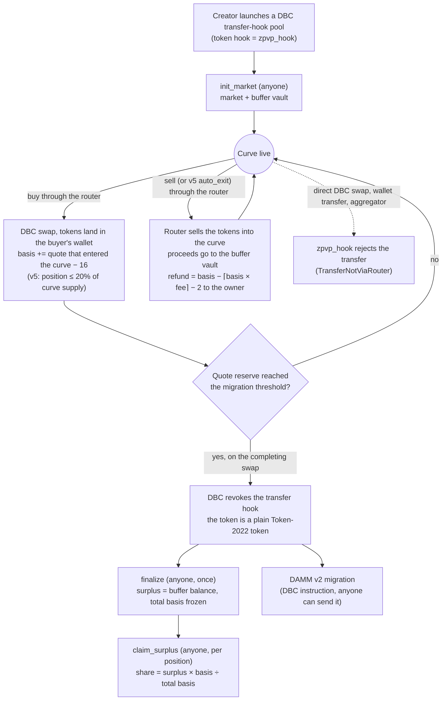

# How it works

Trucee runs a **Zero-PvP curve** on an unmodified Meteora Dynamic Bonding Curve (DBC) pool. The core idea fits in one sentence: **before graduation every buyer can exit at their cost basis, and at graduation whatever those exits left behind is shared by the holders who stayed, pro rata by basis.**

Two Solana programs make that work:

* **`zpvp_router`** records each buyer's cost basis, runs exits at cost from a per-market buffer, and splits the buffer's surplus at graduation.
* **`zpvp_hook`** is the token's Token-2022 transfer hook. It is only the enforcement tool: it lets the token move only inside a router instruction, so the router sees every pre-graduation trade.

Everything else is DBC doing what it already does: the curve, the fees, graduation, revoking the hook, and the migration to DAMM v2.


**What runs where (2026-10-11).** Steps 1 to 7, 9 (Auto-Exit) and 10 (Anti-Whale cap) describe router v5, which runs on devnet since its upgrade on 2026-10-11. Step 8 is DBC's own migration. Trucee's crank runs the jobs for finalize, claims, auto-exits and migrations on its own: on devnet it finalized, migrated and claimed a graduated market unattended. Details: [Status](#status).


## The lifecycle at a glance



## 1. Launch: a DBC pool plus a router market

A creator launches an ordinary DBC pool from a transfer-hook config whose hook program is `zpvp_hook`; DBC creates the Token-2022 mint with that hook. Anyone then writes the hook's extra-account list for the mint (`initialize_extra_account_meta_list`) and opens the router market with `init_market`, which creates:

* the **market** account, PDA `["market", pool]`;
* the **buffer vault**, a quote-token account at PDA `["buffer", market]` whose authority is the market PDA.

`init_market` only accepts pools the refund math is built for:

* the pool and config are DBC transfer-hook accounts and the pool belongs to the config;
* the config's hook program is `zpvp_hook` (error `WrongTransferHook`, 6013);
* the base fee is static (no fee scheduler or rate limiter), the dynamic fee is off and fees are collected in the quote token (`UnsupportedFeeConfig`, 6014);
* the quote mint is on the launch allowlist and the graduation threshold is within its cap (`QuoteMintNotAllowed` 6017, `ThresholdTooHigh` 6018): wSOL up to 10 SOL, TSLAx up to 5 shares, NVDAx up to 10 shares. The xStocks are Token-2022 tokens whose issuer can pause or claw back balances; the [Security](security.md) page covers that risk.

The market stores the pool's fee rate (`fee_numerator`, out of 1,000,000,000) for the refund formula below.

## 2. Buy: the router records your cost basis

Every buy goes through the router's `buy`, which calls DBC's `swap2_with_transfer_hook` for you. The tokens land in **your own wallet** (your canonical associated token account), and your position (PDA `["position", market, wallet]`) grows by:

* `tokens` += the tokens you received;
* `basis` += the quote that entered the curve − 16.

"The quote that entered the curve" is how much the pool's quote reserve grew during your swap. DBC takes its buy fee from your input before that, so the buy fee is a cost you pay, as on any curve. The **16 base units** (16 lamports on a SOL pool) withheld from every buy absorb DBC's rounding, which always favours the pool (at most 14 lamports per round trip in the simulator).

From v5, a buy is also limited by the Anti-Whale cap (step 10).

## 3. Exit at cost

Before graduation you can exit all or part of your position with the router's `sell`. The router:

1. takes the basis of the tokens you exit at average cost: `basis_part = floor(basis × tokens ÷ position tokens)`, and a full exit takes all remaining basis;
2. sells those tokens into the curve at the live price, with the proceeds paid **into the market's buffer vault**, not to you;
3. pays you the refund from the buffer:

```
refund = basis_part − ceil(basis_part × fee_numerator ÷ 1,000,000,000) − 2
```

floored at zero. In words: you get back what you put into the curve, minus the fee you would pay selling at your own cost, minus a **2-unit haircut** per exit that stops many tiny exits from accumulating rounding dust against the buffer.

**Example** (unit test `refund_matches_python_reference`): a basis of 1,000,000,000 lamports (1 SOL) on a pool with a 1% fee (`fee_numerator` 10,000,000) refunds **989,999,998 lamports**: 1 SOL minus a 0.01 SOL fee at cost minus 2 lamports.

A full round trip therefore costs the buy fee, the fee at cost and 18 base units (16 + 2), whatever the price did in between. An exit never pays more than your basis, so before graduation nobody can take profit out of later buyers, and a holder who exits after the price has dropped still gets their cost back. That is what "no PvP until graduation" means.

## 4. The buffer vault

Each market has one buffer vault, and only the router can move money out of it: refunds before graduation, surplus claims after.

Why it can pay every refund: a DBC curve's price depends only on how many tokens are outstanding, so selling walks the price back down the same curve that buying walked up. An exit that sells above its owner's cost leaves the difference in the buffer; an exit that sells below cost draws on it. The design claim is that the buffer never goes negative, for any curve and any order of buys and exits. A Python port of the DBC curve matches the on-chain program swap for swap (21,000 swaps); a model of the router built on it was fuzzed against the claim over 13,800 runs and never produced a negative buffer. On chain, the router also refuses a refund the buffer cannot cover (`BufferInsufficient`, 6015).

## 5. Enforcement: the transfer hook

Exit at cost only works if the router sees every pre-graduation trade, so the token's Token-2022 transfer hook is `zpvp_hook`. Token-2022 calls the hook on every transfer. The hook reads the instructions sysvar and accepts the transfer only if the transaction's **currently executing top-level instruction belongs to the router**; otherwise the transfer fails with `TransferNotViaRouter`.

Before graduation that rejects:

* a direct DBC swap (the top-level program is DBC);
* a wallet-to-wallet transfer (the top-level program is Token-2022);
* an aggregator route or any other program that wraps a swap (the top-level program is not the router).

The router has no transfer instruction of its own. A buy delivers to the buyer's canonical associated token account and an exit takes from the owner's, and Token-2022 associated token accounts cannot change owner, so a position cannot be handed over that way either.

Selling is never blocked: before graduation you can always exit through the router at cost, and at graduation DBC removes the hook. The [Security](security.md) page answers the "is this a honeypot?" question in full.

## 6. Graduation: DBC removes the hook

The curve completes when its quote reserve reaches the config's migration threshold. Buys use DBC's partial-fill mode, so the buy that completes the curve fills only up to that point. On the swap that completes the curve, **DBC itself revokes the transfer hook**: this is DBC's own code, not Trucee's, and Trucee cannot prevent it. From then on the token is a plain Token-2022 token and transfers work like any other token. Selling back into the curve is no longer possible because the pool is complete, so exits at cost end at graduation.

## 7. Surplus split at graduation

1. **`finalize`** (anyone, once per market, only after the curve is complete) freezes two numbers: the buffer balance, which is the surplus, and the total basis of all open positions.
2. **`claim_surplus`** (anyone, once per position) pays `floor(surplus × position basis ÷ total basis)` into the owner's canonical quote token account, then closes the position and returns its rent to the owner. A crank can claim for every holder: it pays only the transaction fee and receives nothing. Total claims can never exceed the frozen surplus (`SurplusOverclaimed`, 6016).

Holders keep their tokens and get the surplus on top. Rounding leaves less than one base unit per position in the buffer.

**On devnet** (the final end-to-end run on router v5, 2026-10-11): the buffer held 15,045,373 lamports at `finalize`. The crank's claims job claimed for all 7 positions and closed them, paying 15,045,370 lamports in total, and 3 lamports of rounding stayed in the buffer.

## 8. Migration to DAMM v2

After graduation, DBC moves the curve's liquidity into a Meteora DAMM v2 pool with its own migration instruction, which any wallet can send. This is DBC code, not Trucee code. It is independent of `finalize` and the surplus claims, which need only a completed curve. On router v5, the crank's migration job migrated the pool of the final devnet end-to-end run (DAMM v2 pool `6W3BGqQDWBJqfrEARB3jfbpWmZaAEjMESyCScnmo8TBP`). The first Zero-PvP pool migrated on devnet, with an earlier router build (v4), was migrated with the official DBC SDK.

Trucee's crank has its own migration job, because Meteora's mainnet keepers migrate SOL pools only when the graduation threshold is 10 SOL or more. The crank runs the job on its own: on devnet, running unattended, it migrated a graduated market's pool and also sent that market's `finalize` and claims.

## 9. Auto-Exit (v5)

Pick a date; if the curve has not graduated by then, anyone can exit your whole position at cost for you.

* **`set_auto_exit(deadline)`**, owner only. The deadline is a Unix time strictly in the future (`AutoExitDeadlineInPast`, 6019); `0` clears it. It cannot be set or cleared once the market is finalized (`AlreadyFinalized`, 6010).
* The owner also approves the market PDA as delegate of their token account for at least the position's tokens. If that approval is revoked or too small, `auto_exit` fails inside Token-2022 and nothing moves.
* **`auto_exit`**, anyone. It checks, in order, that the position is not empty (`InvalidExitAmount`, 6007), that the deadline has been reached (`AutoExitNotDue`, 6020) and that the curve is still live (`AutoExitCurveComplete`, 6021). The market PDA then sells the whole position as the owner's delegate through the same exit-at-cost path as `sell`. The refund always lands in the owner's canonical quote token account, the caller only pays the transaction fee, and the deadline resets to 0.

The hook lets the delegated sale through because the top-level instruction is still the router.

## 10. Anti-Whale cap (v5)

`buy` rejects any buy that would leave the buyer's position above 20% of the curve's sale supply:

```
cap = floor(swap_base_amount × 2,000 ÷ 10,000)
```

`swap_base_amount` is the base supply the DBC config sells before graduation. A buy over the cap fails with `PositionCapExceeded` (6022). On the devnet test config, which sells 185,067,869,081,122 raw units, the cap is 37,013,573,816,224. In the router v5 smoke run on devnet, the cap rejected 14 of 40 random trades live, and in the final end-to-end run a buy above the cap failed with 6022.

* The cap is a program constant, the same for every market.
* It also applies to the buy that completes the curve, so a curve needs at least 5 positions to graduate.
* An exit lowers your position; after it you may buy up to the cap again.
* It is enforceable only because the hook blocks transfers before graduation, so nobody can gather tokens from other wallets. One person can still use several wallets, but each wallet buys up the curve at the curve price like everyone else.

## Status

As of 2026-10-11. "Devnet" is the router upgraded on 2026-10-11 to v5 (slot 509900704), the capped build of commit `3985d1f`. The router source on `main` is that same build: its `zpvp/` tree equals the one at `3985d1f`.

| Piece | Source on `main` | Devnet |
| --- | --- | --- |
| Transfer hook `zpvp_hook` | Merged | Live |
| Cost basis, exit at cost, buffer vault | Merged | Live |
| `finalize` and `claim_surplus` (surplus split) | Merged | Live |
| Quote allowlist and graduation caps | Merged | Live |
| Auto-Exit (`set_auto_exit`, `auto_exit`) | Merged (v5) | Live |
| Anti-Whale cap (20% of curve supply) | Merged (v5) | Live |
| Native Referral (optional referrer on `buy`) | Merged (v5) | Live |
| Zero-PvP preset check in `init_market` (error 6023) | Merged (v5) | Live |
| DAMM v2 migration | DBC instruction | Ran with router v4, and with v5 in the final end-to-end run |
| Crank jobs for finalize, claims, auto-exits and migration | Merged and registered in the crank | Ran unattended on devnet |

Features that are not built are listed on the [Roadmap](roadmap.md), not here.

Devnet program IDs:

* `zpvp_router`: `D4sk6wwELD6cmd7tv6hE4hkxQP8SF8tjdegYym8iWNNb`
* `zpvp_hook`: `CUNNV1MqVB53N4jWn91uVFXm1dBSyaynR6iBCbufJWMS`
* Meteora DBC: `dbcij3LWUppWqq96dh6gJWwBifmcGfLSB5D4DuSMaqN`

## Sources

Paths are relative to the root of the Trucee monorepo. Every number on this page comes from one of these.

| Claim | Source |
| --- | --- |
| Hook rule: the top-level instruction must be the router, else `TransferNotViaRouter` | `zpvp/programs/zpvp_hook/src/lib.rs` (`transfer_hook`, `HookError`) |
| The hook rejects a direct DBC buy and a wallet transfer; DBC revoked the hook at graduation; a plain transfer works after it; selling into the completed curve fails | `litesvm-diff/src/zpvp_e2e.ts` (checks 1, 3 and 6, and the post-graduation checks) |
| Basis = quote reserve growth − 16; the buy fee is taken from the input | `zpvp/programs/zpvp_router/src/lib.rs` (`buy`), `zpvp/programs/zpvp_router/src/math.rs` (`DUST_PER_BUY`, `basis_for_buy`), `sim/zero_pvp.py` and `sim/dbc_curve.py` (module docstrings) |
| At most 14 lamports of DBC rounding per round trip | `zpvp/programs/zpvp_router/src/math.rs` (comment on `DUST_PER_BUY`) |
| Refund formula, haircut 2, denominator 1,000,000,000, average-cost exits | `zpvp/programs/zpvp_router/src/math.rs` (`refund_for`, `HAIRCUT_PER_EXIT`, `FEE_DENOMINATOR`, `basis_for_exit`) |
| 1 SOL basis at a 1% fee refunds 989,999,998 lamports | `math.rs` test `refund_matches_python_reference`; `cd zpvp && cargo test -p zpvp_router` (48 passed, 0 failed on `ba6dcb1`, 2026-10-11) |
| Proceeds go to the buffer, the refund comes from it, `BufferInsufficient` | `zpvp/programs/zpvp_router/src/lib.rs` (`sell`, `exit_at_cost`) |
| 21,000 swaps bit-exact; 13,800 fuzz runs with no negative buffer | `docs/trucee-plan.md` (Core mechanism, "Verified"); `sim/run_fuzz.py`, `sim/zero_pvp.py` |
| `init_market` checks; quote caps of 10 SOL, 5 TSLAx and 10 NVDAx | `zpvp/programs/zpvp_router/src/lib.rs` (`init_market`, `QUOTE_CAPS`, `check_launch_caps`), `zpvp/programs/zpvp_router/src/dbc.rs` (`read_config`) |
| Canonical associated token accounts only; they cannot change owner | `zpvp/programs/zpvp_router/src/lib.rs` (`Swap.user_base`) |
| DBC revokes the hook on the completing swap | `docs/trucee-plan.md` (Core mechanism: DBC `process_swap.rs` lines 364–425); `zpvp/programs/zpvp_hook/src/lib.rs` (module doc) |
| Partial-fill buys | `zpvp/programs/zpvp_router/src/lib.rs` (`buy`, `SWAP_MODE_PARTIAL_FILL`), `sim/dbc_curve.py` (`buy`) |
| Surplus snapshot and pro-rata claim, rent back to the owner, `SurplusOverclaimed` | `zpvp/programs/zpvp_router/src/lib.rs` (`finalize`, `claim_surplus`), `math.rs` (`surplus_share`) |
| Final devnet end-to-end run on router v5: 13 passed, 0 failed; surplus 15,045,373 lamports, 7 claims totalling 15,045,370; a buy above the cap rejected with 6022; DAMM v2 pool `6W3BGqQDWBJqfrEARB3jfbpWmZaAEjMESyCScnmo8TBP` | `worker/scripts/e2e-devnet.ts`; `worker/out/e2e-devnet-final.json` (commit `99c8a42`, steps 6, 9, 10 and 11); devnet migration transaction `2Pos6pHCTzpviqC2HHQ8THR27WGzMMqZGtdKFpN5KqaBDvioF6YE8d8mQyxCPVqdLsb6cmrJeuScxSn6RQXU6mJA` and first claim `4bDKeg824SZtBW27Fq1hba936nbRw5XXE2QwJDbfCzG9w54fJuAkNowWFxH9R8bAtqX18rTNDFF33TdJ6TekGAMF` |
| Devnet router is v5: the capped build of `3985d1f`, 439,104 bytes, sha256 `32d63bde1e8cc925aad7ce59e1e7b9c50ed5d918dea039b2db060f811905bff5`, last deployed in slot 509900704 | `solana program show D4sk6wwELD6cmd7tv6hE4hkxQP8SF8tjdegYym8iWNNb --url devnet`; devnet deploy transaction `4PzU4YFJ2JY26ciZjfCXKVcRUKM8fnYwBGGPrBJrexLTLU86UxnRsPRuHSL4B9FqiUCe8KvooahvKZvxQeVjbS6r`; `docs/mainnet-deploy.md` (Pinned build) |
| Router v5 smoke run on devnet: 15 passed, 0 failed; 14 of 40 random trades rejected with 6022 | `litesvm-diff/out/e2e_devnet_v6.json` (commit `125061c`) |
| Auto-Exit rules; error codes 6007, 6010, 6019, 6020 and 6021 | `zpvp/programs/zpvp_router/src/lib.rs` (`set_auto_exit`, `auto_exit`, `RouterError` and its unit tests); `litesvm-diff/src/zpvp_auto_exit.ts` |
| Anti-Whale: 2,000 bps of `swap_base_amount`, error 6022, devnet cap 37,013,573,816,224, at least 5 positions | `zpvp/programs/zpvp_router/src/lib.rs` (`ANTI_WHALE_BPS`, `anti_whale_cap` and its unit test); `litesvm-diff/src/zpvp_anti_whale.ts`; `docs/trucee-plan.md` (section 3) |
| DAMM v2 migration on devnet with router v4 (history) | `docs/trucee-plan.md` (Core mechanism, "Verified"); `litesvm-diff/src/migrate_devnet.ts` |
| xStock issuers can pause or claw back balances | `docs/trucee-plan.md` (section 1); `zpvp/programs/zpvp_router/src/lib.rs` (comment on `QUOTE_CAPS`) |
| The crank (finalize, claims, auto-exit, migration) runs every job unattended; on devnet one unattended run finalized, migrated and claimed all 6 positions of market `5t7tfUeP2msicPhFihz5vcasYqwk4tKTpgQRui96oyar` | `worker/src/index.ts` (`buildJobs`); `worker/src/crank/jobs/` (`finalize.ts`, `claims.ts`, `auto-exit.ts`, `migrate.ts`); `worker/out/crank-run-devnet.json` (commit `48319aa`) |
| Meteora's mainnet keepers migrate SOL pools only from a 10 SOL threshold | `docs/research/RSC-03.md` (Answer, E1) |
